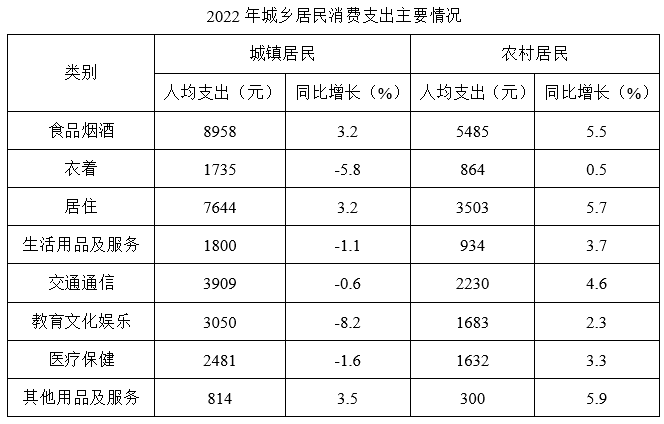

# 材料 · 2022年全国及分城乡居民人均可支配收入与人均消费支出情况，含消费八大类城乡分组

> 关联 5 道小题

**时间口径**：现期为2022年，基期2021年不直接给出、需通过同比增速反推；无预测年份；全部数据为年度当期值（人均值），非累计值；文字注明增长均为同比名义增长（未扣除价格因素）

**单位与换算**：收入与支出单位均为人民币'元'（人均值），增速单位为%；最大量级陷阱在题1：材料给'元'而选项给'万元'，需除以10000换算；表中均为人均指标，材料未给总人口，不能换算成总量；注意同比增速出现负值（如城镇衣着-5.8%），代表负增长

## 结构拆解
- 文字段1（收入）：2022年全国居民人均可支配收入36883元、同比+5.0%；城镇49283元、+3.9%；农村20133元、+6.3%；三个主体×'现期值+增速'两列，为基期计算和混合平均提供数据
- 文字段2（消费支出）：2022年全国居民人均消费支出24538元、同比+1.8%；城镇30391元、+0.3%；农村16632元、+4.5%；与文字段1结构对称，是'收入-支出'对比及混合平均的备用数据
- 统计表《2022年城乡居民消费支出主要情况》：仅2022年一期数据；行指标为8大类——食品烟酒、衣着、居住、生活用品及服务、交通通信、教育文化娱乐、医疗保健、其他用品及服务；列结构为城镇（人均支出元、同比增长%）、农村（人均支出元、同比增长%）双栏；农村8项：食品烟酒5485(+5.5%)、衣着864(+0.5%)、居住3503(+5.7%)、生活用品及服务934(+3.7%)、交通通信2230(+4.6%)、教育文化娱乐1683(+2.3%)、医疗保健1632(+3.3%)、其他用品及服务300(+5.9%)；城镇8项：8958(+3.2%)、1735(-5.8%)、7644(+3.2%)、1800(-1.1%)、3909(-0.6%)、3050(-8.2%)、2481(-1.6%)、814(+3.5%)；可验证：城镇8项之和≈30391、农村8项之和≈16631（尾数舍入差1元），即八大类合计≈该群体人均消费支出总额

## 阅读陷阱
- ⚠ 单位量级陷阱：材料全部以'元'计，题1要求以'万元'作答，36883÷1.05≈35127元≈3.5万元，直接填35127会选错
- ⚠ 同名指标口径不同：'人均可支配收入'与'人均消费支出'是两个并列指标，题2须用城镇收入49283减城镇支出30391，勿用全国值或交叉错配
- ⚠ 城乡两列勿看错：表格城镇/农村双栏结构相同，题3只考农村列，若扫到城镇列（多项负增长）会全盘出错
- ⚠ '同比增加超过120元'考增长量而非增速：需按现期×r/(1+r)折算，不能直接用增速或现期值比较；且衣着等负增长项增加量为负、直接排除
- ⚠ 人均值≠总量：全部为人均指标，材料未给城乡人口数，题4须通过'全国人均值是城乡人均值的加权平均'反解人数比，不能幻想材料里直接有人口数据
- ⚠ 名义增长口径：文字明确'名义增长'，做基期换算时不再叠加价格修正
- ⚠ 八大类合计与人均消费支出总额基本相等（农村差1元属舍入），可用于快速校验数据读取是否正确

## 小题群关系
四题覆盖三种计算模型、彼此独立无连环复用：题1为基期量计算模型（现期36883÷(1+5.0%)），附加元→万元换算；题2为简单减法模型（49283-30391=18892元）；题3为增长量模型（增长量=现期×r/(1+r)），对表格农村8项逐一与120元门槛比较，考'不想全算'的速判技巧（如交通通信2230×4.6%/1.046≈98<120可先排除）；题4为混合平均（十字交叉）模型——全国人均可支配收入36883介于城镇49283与农村20133之间，权重即城乡人数，反解得城镇：农村≈(36883-20133):(49283-36883)=16750:12400≈1.35:1（约4:3），亦可用消费支出24538/30391/16632交叉验证一致性；整组题共同依赖'人均值+名义增速'的数据结构，是基期、增长量、混合平均三大常规模型的标准组合卷

## 关联真题
- [[10-真题/资料分析/增长/5514954 基期量计算（含单位换算）|5514954]] 广东 2023 — 基期量计算（含单位换算）
- [[10-真题/资料分析/其他/5514956 简单计算——两个现期值直接作差（收入-支出差额）|5514956]] 广东 2023 — 简单计算——两个现期值直接作差（收入-支出差额）
- [[10-真题/资料分析/平均数/5514966 混合平均（加权平均）反解权重大小——线段法-十字交叉求人数之比|5514966]] 广东 2023 — 混合平均（加权平均）反解权重大小——线段法-十字交叉求人数之比
- [[10-真题/资料分析/增长/5514960 增长量比较（超过固定门槛的项数计数）|5514960]] 广东 2023 — 增长量比较（超过固定门槛的项数计数）
- [[10-真题/资料分析/综合/5514968 综合分析（四选一正误判断：增长量计算+基期量反推+增长量比较口诀）|5514968]] 广东 2023 — 综合分析（四选一正误判断：增长量计算+基期量反推+增长量比较口诀）

---

### 材料原文

        2022年，全国居民人均可支配收入36883元，比上年增长（以下如无特别说明，均为同比名义增长）5.0%。分城乡看，城镇居民人均可支配收入49283元，增长3.9%；农村居民人均可支配收入20133元，增长6.3%。

        2022年，全国居民人均消费支出24538元，比上年增长1.8%。分城乡看，城镇居民人均消费支出30391元，增长0.3%；农村居民人均消费支出16632元，增长4.5%。

