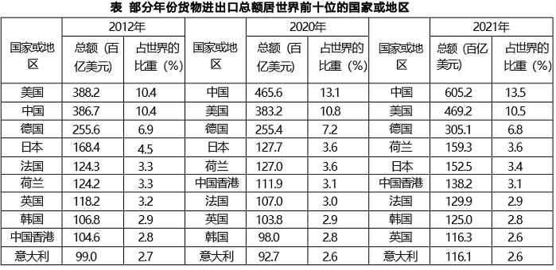

# 材料 · 2021年我国对外贸易总体情况（对外贸易总额、服务贸易、外商直接投资，对比201

> 关联 5 道小题

**时间口径**：现期年2021年，基期年2012年，表中另设中间年份2020年；无预测年份；文字与表中数据均为当期（当年）值、非累计值；'比上年增长30.2%'指2021年对2020年，'年均增长4.8%'指2012-2021年（间隔9年）

**单位与换算**：文字中对外贸易总额用'万亿美元'，服务贸易总额、外商直接投资用'百亿美元'，表格总额列统一用'百亿美元'，比重列用'%'。换算：1百亿美元=1000亿美元=0.1万亿美元。量级陷阱：6.9万亿美元=69百亿美元；82.1百亿美元=0.821万亿美元；表中中国2021年605.2百亿美元=6.052万亿美元，与6.9万亿（货物+服务）口径自洽

## 结构拆解
- 第1段（文字）：①2021年对外贸易总额6.9万亿美元，同比+30.2%（可反推2020年），比2012年多2.5万亿美元（可反推2012年为4.4万亿美元），连续两年世界第一；②服务贸易总额82.1百亿美元，占世界7.2%，较2012年提高1.8个百分点（可反推2012年为5.4%）；③实际使用外商直接投资由2012年11.3百亿美元增至2021年17.4百亿美元，年均增长4.8%
- 第2部分（统计表'部分年份货物进出口总额居世界前十位的国家或地区'）：三个年份（2012、2020、2021）各占一组三列，每列为'国家或地区、总额（百亿美元）、占世界的比重（%）'；三个年份均为同十个主体（中国、美国、德国、日本、法国、荷兰、英国、韩国、中国香港、意大利），但排名顺序不同，同一国家或地区需跨年份列对照读取

## 阅读陷阱
- ⚠ 单位混排：'万亿美元'与'百亿美元'并存，量级差10倍、100倍，直接代入计算前必须换算，表头'总额(百亿美元)'易误看成'亿美元'
- ⚠ 同名易混指标：文字'对外贸易总额'（货物+服务，2021年6.9万亿美元）≠表中'货物进出口总额'（2021年中国605.2百亿美元=6.052万亿美元），两者口径不同不能互相替代
- ⚠ 表中三年榜单排名不同，读数时必须先锁定年份列再找国家行，易串列串行
- ⚠ 关键基期数据均需换算、表中查不到：2020年对外贸易总额=6.9÷(1+30.2%)；2012年对外贸易总额=6.9-2.5=4.4万亿美元；2012年服务贸易占比=7.2%-1.8=5.4%
- ⚠ '提高1.8个百分点'是百分数相减而非增长率；'年均增长4.8%'的年数取9年（2012至2021），做验证类选项时勿按10年算

## 小题群关系
本组围绕五个模型：第1题为基期量计算（6.9万亿与+30.2%反推2020年）；第2题为表中2021年相对2020年的同比增速比较（逐国两列相除，找最小者）；第3题为比重百分点还原（7.2%-1.8个百分点=5.4%）；第4题为跨年份增减筛选（逐国对比2021列与2012列总额，注意两列单位同为百亿美元可直接比）；第5题为综合分析/不能推出类，需文字与表格串联判断。题与题之间无明显的连环复用（上一题结果不作为下一题条件），但第5题常复用或呼应前几题的计算路径，共用同一段文字与同一张表

## 关联真题
- [[10-真题/资料分析/增长/5746645 增长率比较（同比增速找最小）|5746645]] 江苏 2023 — 增长率比较（同比增速找最小）
- [[10-真题/资料分析/比重/5746648 基期比重之百分点还原（现期比重−提高的百分点）|5746648]] 江苏 2023 — 基期比重之百分点还原（现期比重−提高的百分点）
- [[10-真题/资料分析/综合/5746653 综合分析选非题（增长量计算与位次比较混合验证）|5746653]] 江苏 2023 — 综合分析选非题（增长量计算与位次比较混合验证）
- [[10-真题/资料分析/增长/5746641 基期量计算|5746641]] 江苏 2023 — 基期量计算
- [[10-真题/资料分析/增长/5746650 增长量正负判断计数（跨年份逐主体筛选）|5746650]] 江苏 2023 — 增长量正负判断计数（跨年份逐主体筛选）

---

### 材料原文

        2021年，我国对外贸易总额为6.9万亿美元，比上年增长30.2%，比2012年多2.5万亿美元，连续两年成为世界第一大贸易国。其中，服务贸易总额82.1百亿美元，占世界的比重升至7.2%，较2012年提高1.8个百分点。实际使用外商直接投资，由2012年的11.3百亿美元增加到2021年的17.4百亿美元，年均增长4.8%。

