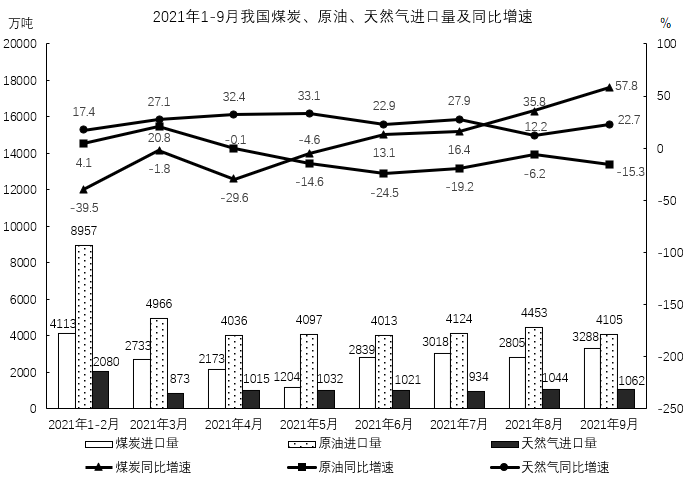

# 材料 · 2021年1-9月我国煤炭、原油、天然气三类能源的月度进口量（万吨）及同比增速（

> 关联 5 道小题

**时间口径**：现期为2021年1-9月，按时间列示8个横轴刻度：'2021年1-2月'（两月合并）+3月至9月各单月；折线给的是同比增速，对应基期为2020年同期，可反推2020年3-9月单月进口量；无预测年份；除'1-2月'为两个月累计值外，其余各格均为当月值

**单位与换算**：进口量单位为万吨（左轴0-20000）；同比增速单位为%（右轴-250~100）。需注意：①基期量=现期量÷(1+增速)，增速为负时即除以(1-|增速|)，如2021年3月原油增速-1.8%，基期=4966/(1-0.018)；②'日均'类问题需配准确天数（2021年上半年181天、1-9月273天）；③万吨与亿吨的量级换算（1亿吨=10000万吨）；④1-2月柱值是两个月之和，求月均须÷2或按区间总天数处理

## 结构拆解
- 单张双轴复合图：标题'2021年1-9月我国煤炭、原油、天然气进口量及同比增速'；横轴8个时间段（1-2月合并、3月-9月）；左轴（万吨）对应三组柱：煤炭进口量（白柱）、原油进口量（点状柱）、天然气进口量（深色柱）；右轴（%）对应三条折线：煤炭同比增速（▲三角标记）、原油同比增速（■方块标记）、天然气同比增速（●圆点标记）；所有柱值与增速点均直接标注数值
- 柱状图数据明细（万吨，对应1-2月/3月/4月/5月/6月/7月/8月/9月）：煤炭4113、2733、2173、1204、2839、3018、2803、3288；原油8957、4966、4036、4097、4013、4124、4453、4105；天然气2080、873、1015、1032、1021、934、1044、1062
- 折线数据明细（同比增速%，同上顺序）：煤炭-39.5、20.8、-29.6、-4.6、13.1、16.4、35.8、57.8；原油4.1、-1.8、-0.1、-14.6、-24.5、-19.2、-6.2、-15.3；天然气17.4、27.1、32.4、33.1、22.9、27.9、12.2、22.7

## 阅读陷阱
- ⚠ '1-2月'是两月合并值：既不能当单月数据参与环比/月均，求1-9月总量时也只能整体加一次，易被重复或拆错
- ⚠ 季度、半年度数据需自行拼合：二季度=4+5+6月，三季度=7+8+9月，上半年=1-2月+3月+4月+5月+6月，材料不直接给出
- ⚠ 折线与柱的品种对应靠标记形状区分，8月附近煤炭35.8、原油-6.2、天然气12.2三条线交叉密集，增速错配到品种是高频失误点
- ⚠ 反推2020年数据时负增速处理易错：应除以(1-|增速|)，常见误算为乘(1+增速)或把负号弄丢
- ⚠ 单位为万吨，若选项出现亿吨或'日均约多少万吨'需换算/配准天数，量级差异大（如上半年天然气合计约6021万吨÷181天≈33万吨/日）
- ⚠ 环比比较只能从4月开始（4月对3月），3月对'1-2月'无严格单月环比参照

## 小题群关系
五题共用同一张复合图，核心模型是'柱值分段加总 + 折线增速基期换算'：第1题为现期合计+日均模型（上半年天然气五段加总÷181天）；第2题为负增速基期量模型（2020年3-9月各月原油=2021年当月值÷(1+增速)，比较大小找最大月）；第3题为基期合计求增长率（2021年三季度煤炭合计9109万吨与2020年三季度合计之比）；第4题为环比方向逐月判断（原油、天然气两列柱逐月比大小，限定二、三季度即4-9月，注意1-2月合并导致3月无参照）；第5题为比重构成/饼图模型（三品种1-9月合计：原油约3.88亿吨过半、煤炭约2.22亿吨约三成、天然气约0.91亿吨约一成三，据此选饼图）。五题之间无上一题答案被下一题直接复用的连环关系，但第2、3、5题共享'先加总、再基期换算'步骤，第1、4、5题共享'1-2月作整体处理'的口径约定

## 关联真题
- [[10-真题/资料分析/平均数/5802111 现期平均数（日均进口量=区间总量÷区间天数）|5802111]] 浙江 2023 — 现期平均数（日均进口量=区间总量÷区间天数）
- [[10-真题/资料分析/增长/5802113 基期量比较（负增速基期换算后比大小）|5802113]] 浙江 2023 — 基期量比较（负增速基期换算后比大小）
- [[10-真题/资料分析/增长/5802114 基期合计求增长率（混合增长率定性排除）|5802114]] 浙江 2023 — 基期合计求增长率（混合增长率定性排除）
- [[10-真题/资料分析/其他/5802118 环比方向逐月判断与双品种交集计数|5802118]] 浙江 2023 — 环比方向逐月判断与双品种交集计数
- [[10-真题/资料分析/比重/5802136 现期比重构成（饼图选项判断）|5802136]] 浙江 2023 — 现期比重构成（饼图选项判断）

---

### 材料原文

