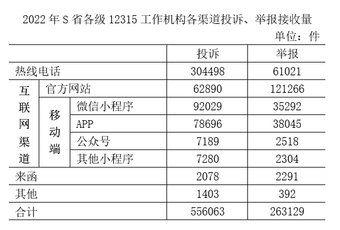
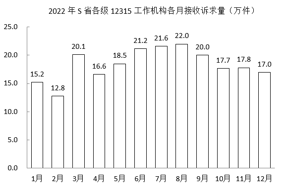

# 材料 · 2022年S省各级12315工作机构接收诉求状况：三类诉求（投诉/举报/咨询）总

> 关联 5 道小题

**时间口径**：现期为2022年全年；基期2021年未直接给出数值，仅通过'比上一年分别增加14.0/8.9/16.0万件'间接呈现，须用'现期－增长量'反推基期；月度图为2022年当月值（非累计值）；无预测年份

**单位与换算**：正文与月度图单位为万件（月度图保留1位小数），渠道统计表单位为件（精确到个位）；件换算成万件需÷10000：合计556063件≈55.6万件、263129件≈26.3万件，与正文衔接；比重比较的差用'百分点'表述；12个月加总=220.5万件，与正文全年220.4万件有0.1万件尾差（各月四舍五入所致）

## 结构拆解
- 文字段：给出2022年总盘子与三类构成。总接收诉求220.4万件、同比+21.41%；投诉55.6万件、举报26.3万件、咨询138.5万件，及各自比上一年增加14.0/8.9/16.0万件（可反推2021年基期值：投诉41.6、举报17.4、咨询122.5万件）
- 统计表《2022年S省各级12315工作机构各渠道投诉、举报接收量》（单位：件，仅2022年一年）：渠道为热线电话（投诉304498、举报61021）、互联网渠道—官方网站（62890/121266）、互联网渠道—移动端（微信小程序92029/35292、APP78696/38045、公众号7189/2518、其他小程序7280/2304）、来函（2078/2291）、其他（1403/392），合计行：投诉556063件、举报263129件（表内各项加总与合计可互相验证）
- 柱状图《2022年S省省级12315工作机构各月接收诉求量》（万件，1—12月当月值）：1月15.2、2月12.8、3月20.1、4月16.6、5月18.5、6月21.2、7月21.6、8月22.0、9月20.0、10月17.7、11月17.8、12月17.0；峰值8月22.0、谷值2月12.8，3月环比跳升最大（+7.3）

## 阅读陷阱
- ⚠ 口径表述差异：月度图标题为'省级'机构，正文为'各级'机构，做题前须核对；且12个月合计≈220.5万件与正文全年220.4万件高度吻合（尾差为四舍五入），月度数据实为全年总量的月度拆分，勿因标题用词误判两套数据不可比
- ⚠ 单位陷阱：表格是'件'、正文和月度图是'万件'，混算必须换算量级（如304498件=30.4498万件）
- ⚠ 基期值陷阱：同比增速不能拿增长量直接除以现期量，须先反推基期（现期－增长量），如投诉基期=55.6－14.0=41.6万件
- ⚠ 结构缺口：渠道表只覆盖投诉和举报，不含咨询；咨询的结构数据材料中完全没有，综合判断题常在此设'无法推出'选项
- ⚠ 层级嵌套：'移动端'是'互联网渠道'的子集（互联网渠道=官方网站+移动端四项），横向加总时勿把层级重复计算
- ⚠ 月度图为当月值非累计值；环比增量需相邻两月相减自行计算（如2月-2.4、3月+7.3），季度量需三个月相加（一季度48.1、二季度56.3、三季度63.6、四季度52.5万件），图表本身不直接给出

## 小题群关系
这组题围绕四类基础模型展开，数据源分工明确：第1题考'增长量/基期量'型同比增速排序（14.0/41.6 vs 8.9/17.4 vs 16.0/122.5），只用正文段；第2题考'比重+比重差'（304498/556063 vs 61021/263129，约54.8% vs 23.2%），只用渠道表；第3题考'环比增量+折线趋势识别'、第4题考'季度加总比较'（一季度最少48.1万件），两题共用月度柱状图，第3题算出的各月增量可顺势复用于确认第4题的区间划分但季度总量仍需独立加总；第5题为综合判断题，跨正文+表+图三块取数，重点核对'咨询无渠道结构''月度图口径'等前几题已涉及的坑。各题无'上一题结果直接喂给下一题'的硬连环，主要靠共享同一套材料数据与口径陷阱形成呼应

## 关联真题
- [[10-真题/资料分析/增长/5893728 增长率比较（增长量已知、基期量需反推）|5893728]] 国考 2024 — 增长率比较（增长量已知、基期量需反推）
- [[10-真题/资料分析/比重/5893730 现期比重计算与比重差（百分点）比较|5893730]] 国考 2024 — 现期比重计算与比重差（百分点）比较
- [[10-真题/资料分析/其他/5893734 季度加总比较（月度数据求和后比大小）|5893734]] 国考 2024 — 季度加总比较（月度数据求和后比大小）
- [[10-真题/资料分析/增长/5893735 增长量比较——环比增量计算与趋势匹配|5893735]] 国考 2024 — 增长量比较——环比增量计算与趋势匹配
- [[10-真题/资料分析/综合/5893736 综合判断·选非题（环比增量比较＋峰谷倍数＋渠道比重比较＋跨层级加总）|5893736]] 国考 2024 — 综合判断·选非题（环比增量比较＋峰谷倍数＋渠道比重比较＋跨层级加总）

---

### 材料原文

        2022年，S省各级12315工作机构共接收诉求220.4万件，同比增长21.41%。其中，投诉55.6万件、举报26.3万件、咨询138.5万件，比上一年分别增加14.0万件、8.9万件、16.0万件。

