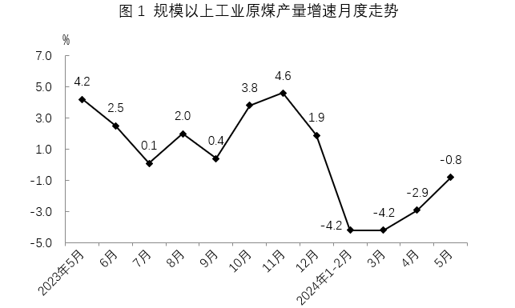
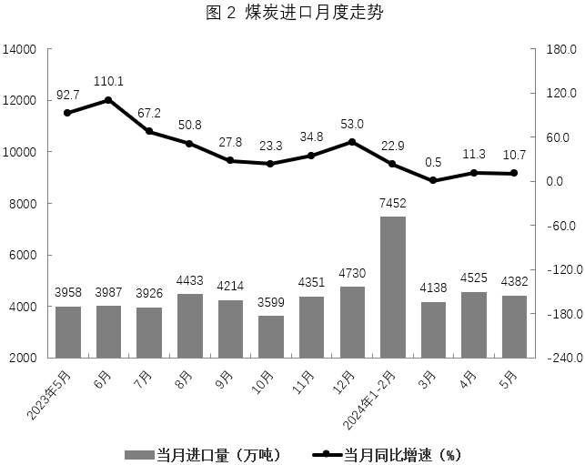

# 材料 · 2023年5月至2024年5月规模以上工业原煤产量（月度同比增速）与煤炭进口量（

> 关联 4 道小题

**时间口径**：现期为2024年5月（当月值：产量3.8亿吨、进口4382万吨）和2024年1-5月（累计值：产量18.6亿吨、进口2亿吨）；基期为2023年同期；图1、图2时间轴均为2023年5月—2024年5月共12个时间点，其中'2024年1-2月'为两个月合并值（非单月数据）；全部为统计值，无预测年份；当月值与累计值混排

**单位与换算**：原煤产量：文字用'亿吨'，图1只有增速%（无数值轴外的产量绝对值）；煤炭进口：图2柱状图为'万吨'，文字为'亿吨'（2亿吨），增速为%；日均产量为万吨/日（1238.2万吨/日）。换算与量级陷阱：1亿吨=10000万吨，5月产量3.8亿吨=38000万吨；文字'1-5月进口2亿吨'与图2柱子加和（7452+4138+4525+4382=20497万吨≈2.05亿吨）存在四舍五入差；图2为双轴图，左轴为万吨（2000-14000），右轴为%（-180.0~180.0），柱读左轴、线读右轴，勿读串

## 结构拆解
- 文字段：给出两组口径——①2024年5月当月：原煤产量3.8亿吨、同比-0.8%、降幅比4月收窄2.1个百分点、日均产量1238.2万吨、进口4382万吨（同比+10.7%）；②2024年1-5月累计：原煤产量18.6亿吨（同比-3%）、进口煤炭2亿吨（同比+12.6%）。这是全套材料中唯一的产量/进口绝对值现期来源
- 图1（折线图）：规模以上工业原煤产量当月同比增速（%），横轴自2023年5月至2024年5月共12个时间点，数值依次为：2023年5月4.2、6月2.5、7月0.1、8月2.0、9月0.4、10月3.8、11月4.6、12月1.9、2024年1-2月-4.2、3月-4.2、4月-2.9、5月-0.8。只有增速，无产量绝对值；'2024年1-2月'为合并期增速
- 图2（柱线双轴图）：柱=当月煤炭进口量（万吨，读左轴），线=当月同比增速（%，读右轴），时间轴与图1完全对齐：2023年5月3958（92.7%）、6月3987（110.1%）、7月3926（67.2%）、8月4433（50.8%）、9月4214（27.8%）、10月3599（23.3%）、11月4351（34.8%）、12月4730（53.0%）、2024年1-2月7452（22.9%）、3月4138（0.5%）、4月4525（11.3%）、5月4382（10.7%）。其中7452万吨是1月+2月的合计柱，不是单月值

## 阅读陷阱
- ⚠ 图2中'2024年1-2月'的7452万吨和22.9%均为两月合并口径，不能当单月值使用：算2024年一季度进口必须用7452+4138=11590万吨，算单月环比时该点无法参与，单月数据1月、2月各自数值不可得
- ⚠ 图1的'2024年1-2月'-4.2%同理为合并期增速，与3月起的单月增速口径不同
- ⚠ 单位混排：文字原煤产量用亿吨、图2进口用万吨，跨源加总或比较时必须统一换算（1亿吨=10000万吨）；且文字'进口2亿吨'与图2柱子加和约2.05亿吨有四舍五入误差，验证时以题目指定口径为准
- ⚠ 图1只有增速没有产量绝对值，求任何月份基期产量都必须回到文字段取现期绝对值（3.8亿吨、18.6亿吨）再除以（1+增速）
- ⚠ '原煤产量同比增速'（图1）与'煤炭进口同比增速'（图2）是两套不同对象的指标，数值接近（如5月：-0.8%对10.7%）时极易张冠李戴
- ⚠ 时间轴从2023年5月起步，2023年1-4月的产量/进口数据材料中完全没有，涉及2023年全年的排序或加总只能在2023年5-12月范围内做
- ⚠ 图2右轴增速刻度含大幅负值区间（至-180.0%），2023年因低基数增速高达110.1%，读线时注意与柱（万吨）量级完全分离

## 小题群关系
四道题围绕两个核心模型：①读图排序模型——题1直接读图1对2023年5-12月产量增速排序，纯读数无计算；②'合并期拆分+基期换算'模型——题2（2024年Q1进口7452+4138=11590万吨 对 2023年Q4进口3599+4351+4730=12680万吨的比较）与题3（进口量环比增速比较，必须避开1-2月合并点，正增长主要看2024年4月环比4525/4138一类）都依赖把合并柱正确嵌入加总；题4（1-4月产量同比降幅）用文字'1-5月累计18.6亿吨（-3%）减5月当月3.8亿吨（-0.8%）'得1-4月现期14.8亿吨，再倒推2023年基期求降幅，属'累计-当月'拆分+增速倒推基期的混合模型。四题之间无上一题答案被下一题直接引用的连环复用，但题2、3、4共享'合计值与单月值拆分'这一关键技能，且题2、3、4分别对应图2、图2、文字段+图1，形成'同一材料多口径交叉验证'的命题结构；文字段中'降幅比4月收窄2.1个百分点'与图1（-0.8%对-2.9%）互相印证，可作数据校验点

## 关联真题
- [[10-真题/资料分析/增长/18508028 增长率读数比较（图1纯读图排序，无计算）|18508028]] 山东 2025 — 增长率读数比较（图1纯读图排序，无计算）
- [[10-真题/资料分析/增长/18508051 混合增长率（居中夹逼求整体增速）|18508051]] 山东 2025 — 混合增长率（居中夹逼求整体增速）
- [[10-真题/资料分析/增长/18508080 增长量计算与环比增长率（季度汇总比较，含合并期拆分）|18508080]] 山东 2025 — 增长量计算与环比增长率（季度汇总比较，含合并期拆分）
- [[10-真题/资料分析/增长/18508046 环比增长率计算与比较|18508046]] 山东 2025 — 环比增长率计算与比较

---

### 材料原文

        2024年5月，规模以上工业原煤产量3.8亿吨，同比增长-0.8%，降幅比4月收窄2.1个百分点，日均产量1238.2万吨，进口4382万吨，同比增长10.7%，2024年1-5月规模以上工业原煤产量18.6亿吨，同比下降3%，进口煤炭2亿吨，同比增长12.6%。

