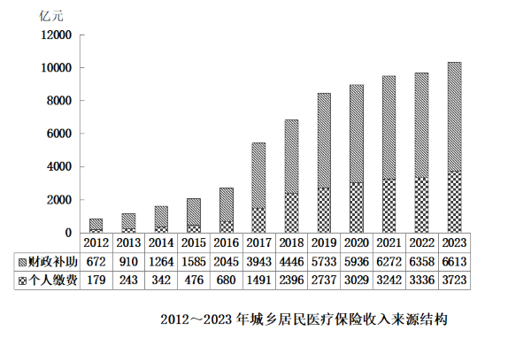

# 材料 · 以2024年底城乡居民基本医疗保险参保人数与收支为现期数据，配以2012~202

> 关联 5 道小题

**时间口径**：文字段为现期口径：2024年底参保人数为时点数，2024年收入、支出为当年时期数；统计图为2012~2023年共12年的各年当期（年度）值，非累计值；材料不含预测年份；题2增速计算需以图表2023年作基期

**单位与换算**：文字段单位：参保人数为万人，收入支出为亿元；图表纵轴单位为亿元（标注在图左上角）。核心换算陷阱：亿元÷万人=万元/人，求'人均多少元'须再×10^4（如11180.91亿元÷94713.73万人≈1180元/人，而非0.118）；图表数据均为亿元量级（百位至千位），与文字段11180.91亿元同量级可直接比较

## 结构拆解
- 文字段（1段）：给出2024年底城乡居民基本医疗保险3个指标——参保94713.73万人、收入11180.91亿元、支出10661.49亿元，供人均、增长率类题目使用
- 堆积柱状图《2012~2023年城乡居民医疗保险收入来源结构》：分两段堆积，下方斜纹为财政补助（2012年672→2023年6613亿元：672、910、1264、1585、2045、3943、4446、5733、5936、6272、6358、6613），上方格纹为个人缴费（2012年179→2023年3723亿元：179、243、342、476、680、1491、2396、2737、3029、3242、3336、3723），共12年年度数据，柱高=两项之和

## 阅读陷阱
- ⚠ 名称口径差异：文字段称'城乡居民基本医疗保险'，图表标题为'城乡居民医疗保险'，实为同一制度数据，跨文字与图表拼接时不要误判为两个口径
- ⚠ 图表只给收入两个来源，2023年财政补助+个人缴费合计10336亿元，是题2求2024年收入增长率时唯一可用的基期近似（总收入口径中可能含少量其他来源，材料未给出）
- ⚠ 堆积柱读数陷阱：易把柱顶（两项合计）误读为财政补助单项值，题3~5须按表格数值分别取数
- ⚠ 题3要求2019~2023年'累计'收入，而图表为各年当期值，需逐年相加（5733+5936+6272+6358+6613），不能直接读某一柱高
- ⚠ 人均计算的双重换算：亿元÷万人后还要×10^4化为'元'，且分母为'期末参保人数'（题干已限定按期末人数）
- ⚠ 增速计数（题4）须逐项两两相除，2012年为首年无同比，2013年起才可比；注意2017年个人缴费跳升（680→1491）属真实数据而非读错柱

## 小题群关系
这组题覆盖资料分析五大基础模型：题1为平均数模型（人均收入-人均支出，仅用文字段2024年数据，亿元/万人换算）；题2为增长率模型（2024年收入11180.91亿元，基期须回图表取2023年两项合计10336亿元，是唯一跨文字+图表拼数据的小题）；题3为累加求和模型（2019~2023财政补助累计）；题4为同比增速计数模型（个人缴费2013~2023各年增速是否>20%，约6个年份满足）；题5为比重趋势模型（2016~2019年财政补助÷当年收入合计，需先对各年两段求和再算比重，趋势为先降后升）。五题间无上一题答案被下一题直接复用的连环关系，但题2与题5共享'收入=财政补助+个人缴费'的加总前提，题3、4、5全部依赖图表同一张表，读准两行数据即可全组通解

## 关联真题
- [[10-真题/资料分析/比重/18643750 现期比重计算与比重变化趋势判断（折线图匹配）|18643750]] 天津 2026 — 现期比重计算与比重变化趋势判断（折线图匹配）
- [[10-真题/资料分析/平均数/18643743 现期平均数作差（人均收入-人均支出之差，同分母先减后除）|18643743]] 天津 2026 — 现期平均数作差（人均收入-人均支出之差，同分母先减后除）
- [[10-真题/资料分析/增长/18643744 一般增长率计算（现期在文字段、基期需图表两来源加总的跨材料拼接）|18643744]] 天津 2026 — 一般增长率计算（现期在文字段、基期需图表两来源加总的跨材料拼接）
- [[10-真题/资料分析/其他/18643746 多期当期值累加求和（累计收入区间判断）|18643746]] 天津 2026 — 多期当期值累加求和（累计收入区间判断）
- [[10-真题/资料分析/增长/18643747 同比增长率比较与计数（增速是否超过20%的年份个数）|18643747]] 天津 2026 — 同比增长率比较与计数（增速是否超过20%的年份个数）

---

### 材料原文

        截至2024年底，城乡居民基本医疗保险参保94713.73万人，收入11180.91亿元，支出10661.49亿元。

