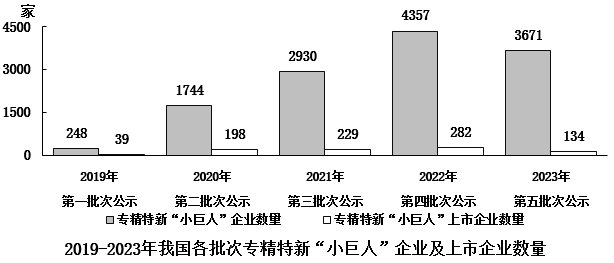

# 材料 · 2019-2023年我国五批次公示的专精特新'小巨人'企业及其中上市企业数量，分

> 关联 5 道小题

**时间口径**：现期为2023年（第五批次公示），无基期年、无预测年份；图1为各批次'当年公示'的当期值（第一批2019年至第五批2023年，一年一批），图2为2019-2023年五批次累计值，两种时间口径混排

**单位与换算**：全部以'家'为单位（图1纵轴标注'家'，表格列名'企业数（家）'）；材料未直接给出任何百分比，所有比重、占比、平均数均需自行计算；量级：全国企业总数≈12950家、上市企业总数≈882家（均需自己加总）；注意图1纵轴刻度间隔为1500，白色小柱数值易误读

## 结构拆解
- 图1（双柱图，标题'2019-2023年我国各批次专精特新小巨人企业及上市企业数量'）：横轴为五个批次（第一批次公示2019年、第二批次公示2020年、第三批次公示2021年、第四批次公示2022年、第五批次公示2023年），每组两根柱：灰色柱=专精特新'小巨人'企业数量（248/1744/2930/4357/3671家），白色柱=专精特新'小巨人'上市企业数量（39/198/229/282/134家），均为各批次当期值，数据覆盖2019-2023全部五个批次
- 图2（表格，标题'2019-2023年我国部分城市五批次累计专精特新小巨人企业数量'）：列示10个城市（上海、深圳、北京、苏州、杭州、成都、南京、广州、无锡、合肥），每组指标含'企业数（家）+全国城市排名'和'上市企业数（家）+全国城市排名'：上海713/第3、73/第1；深圳755/第2、73/第1；北京840/第1、64/第3；苏州402/第4、41/第4；杭州325/第6、39/第5；成都288/第9、30/第6；南京213/第13、29/第7；广州249/第11、23/第8；无锡234/第12、23/第8；合肥193/第15、19/第10；数值均为五批次累计值

## 阅读陷阱
- ⚠ 两图口径不同：图1是各批次'当年公示'的当期值，图2是'五批次累计'值，且图2仅列部分城市——全国总量只能用图1各批次加总（企业12950家、上市882家），跨图计算（如第4题四大城市占全国比重=图2累计数÷图1加总数）极易混用口径
- ⚠ 表格排名并列：上海与深圳上市企业数均为73家、并列排名1；广州与无锡均为23家、并列排名8；'排名'不等于数量互不相同，比较时不能只看排名差
- ⚠ 图1白色柱（上市企业数量）数值远小于灰色柱（最高282 vs 4357），柱形几乎贴地，易被忽略或读错数值
- ⚠ 材料未直接给出'全国总数'与任何'比重'，第1、4、5题都需先自行加总做分母；第1题门槛是882×5%=44.1家，需逐城与图2上市企业数比较
- ⚠ 第3题求'非上市企业'：必须用第五批次企业数量3671减去上市企业134得3537，再除以300个城市，直接用3671会掉坑
- ⚠ 第5题饼图考上市企业的批次构成，份额=各批次上市数/882，其中第五批次(134)与第一批次(39)份额小且接近的倍数关系易画错

## 小题群关系
本组题围绕两大模型：（1）比重模型——第2题（各批次上市企业占本批次企业比重比较）、第5题（上市企业内部各批次占比对应饼图）、第1题（各城市上市企业占全国比重）、第4题（四大城市企业数占全国比重）均为'部分/整体'结构，整体分母需从图1加总获得；（2）平均数模型——第3题用（第五批次总数−上市数）÷300个城市。连环复用明显：第2题与第5题共用图1的上市企业批次序列39/198/229/282/134；第1题与第4题共用图2累计数据和'全国总量=图1加总'这一隐含桥梁；第3题直接在图1第五批次两个数据间做减法。各题数据互不独立，前一题建立的全国总量、批次占比可作为后续题的复用中间量。

## 关联真题
- [[10-真题/资料分析/比重/19283749 现期比重比较（逐组求比重比大小）|19283749]] 国考 2025 — 现期比重比较（逐组求比重比大小）
- [[10-真题/资料分析/比重/19283752 现期比重计算（部分城市累计和÷全国各批次加总，跨图取数）|19283752]] 国考 2025 — 现期比重计算（部分城市累计和÷全国各批次加总，跨图取数）
- [[10-真题/资料分析/比重/19283765 现期比重结构比较（饼图匹配）|19283765]] 国考 2025 — 现期比重结构比较（饼图匹配）
- [[10-真题/资料分析/比重/19283748 现期比重比较（部分量-整体×5%门槛转化计数）|19283748]] 国考 2025 — 现期比重比较（部分量-整体×5%门槛转化计数）
- [[10-真题/资料分析/平均数/19283750 现期平均数计算（总数需先做'减上市企业'修正再除以城市数）|19283750]] 国考 2025 — 现期平均数计算（总数需先做'减上市企业'修正再除以城市数）

---

### 材料原文

