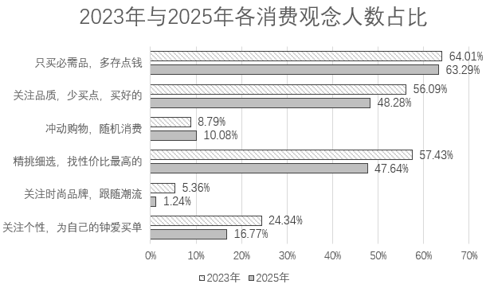

# 材料 · 2025年初某杂志社联合民生智库开展的城乡居民消费调查，围绕居民收支状况、线上/

> 关联 5 道小题

**时间口径**：调查现期为2025年初；文字含三个时间层：2024年实际收入状况（回溯）、2025年收入预期（预期值）、2023年与2025年消费观念占比（图表两期对比）；所有数据均为调查时点的占比（当期截面值），无累计值

**单位与换算**：全部数据单位为百分比(%)；群体差异数据以'个百分点'形式间接给出（如00后比70后高53.79个百分点），需做差换算成具体占比；小题2需用'亿人×百分比'换算成人数（量级为亿人/千万人级）；'近三成'为模糊表述，精确值应为100%-48.07%-22.01%=29.92%

## 结构拆解
- 文字第1段：调查背景交代（2025年初、杂志社联合民生智库、城乡居民收支与消费调查），无数据
- 文字第2段：收入状况与预期。2024年实际：收入持平48.07%、增加22.01%（其中明显增加6.09%）、减少近三成（其中明显减少11.23%）；2025年预期：基本持平46.10%、增加19.04%、不确定23.28%、明显减少11.58%，四项合计100%
- 文字第3段：购物渠道及群体差异。总体：线上为主47.01%、线上线下并重37.52%、线下为主15.48%（合计100%）；间接数据：00后线上69.8%（比70后高53.79pp）、城镇50.18%（高于农村11.66pp）、务农比农村低19.74pp、硕士以上62.81%对比初中及以下22.63%
- 统计图：2023年与2025年各消费观念人数占比（斜纹条=2023年，灰条=2025年），6类观念各给两期数据——只买必需品多存点钱64.01%/63.29%、关注品质少买点买好的56.09%/48.28%、冲动购物随机消费8.79%/10.08%、精挑细选找性价比57.43%/47.64%、关注时尚品牌跟随潮流5.36%/1.24%、关注个性为钟爱买单24.34%/16.77%；横轴0%-70%

## 阅读陷阱
- ⚠ 图例方向易混：斜纹条是2023年、灰色条是2025年，若看反则'冲动购物''关注时尚'等观念的升降方向全错
- ⚠ 70后、农村、务农三组线上占比材料均未直接给出，须连环做差推算：70后=69.8%-53.79%=16.01%；农村=50.18%-11.66%=38.52%；务农=38.52%-19.74%=18.78%
- ⚠ '近三成收入减少'不能直接按30%扣减，'未减少'比例应精确取48.07%+22.01%=70.08%
- ⚠ 2024年实际收入占比与2025年收入预期占比口径不同（实际vs预期），各自为独立分组，不可混为一组相加
- ⚠ 图表'消费观念占比'与文字'收入/渠道占比'是不同调查维度，数据互不相干，不可跨维度拼接；但小题2需'图表占比×人口总数'跨信息源计算
- ⚠ 百分点差与百分比倍数易混淆：如'高53.79个百分点'是做差而非相除

## 小题群关系
本组题围绕'比重类计算模型'展开：小题1为同图两占比相除求倍数（10.08%÷1.24%）；小题2为'比重×总量'模型，用图中'只买必需品'两年占比分别乘给定人口14.12亿/14.08亿再作差比较；小题3为间接数据做差推算+排序（16.01%、18.78%、22.63%）；小题4为两个独立占比的交叉（乘积）计算（70.08%×46.10%×调查总样本）。四题相互独立、无上一题结果被下一题复用的连环关系，但小题1、2共用统计图，小题3、4共用文字段落，做题时须先按小题定位到对应信息源

## 关联真题
- [[10-真题/资料分析/比重/18643959 两集合容斥原理求交集最值（同时满足两条件的最小-最大占比）|18643959]] 浙江 2026 — 两集合容斥原理求交集最值（同时满足两条件的最小-最大占比）
- [[10-真题/资料分析/倍数/18643956 现期倍数计算（同一整体两占比相除求倍数）|18643956]] 浙江 2026 — 现期倍数计算（同一整体两占比相除求倍数）
- [[10-真题/资料分析/比重/18643958 百分点差连环做差推算与占比排序|18643958]] 浙江 2026 — 百分点差连环做差推算与占比排序
- [[10-真题/资料分析/比重/18643957 现期比重计算（部分=整体×比重，两期部分量作差与阈值比较）|18643957]] 浙江 2026 — 现期比重计算（部分=整体×比重，两期部分量作差与阈值比较）
- [[10-真题/资料分析/综合/18643960 综合分析·选非题（文字+图表逐项验证）|18643960]] 浙江 2026 — 综合分析·选非题（文字+图表逐项验证）

---

### 材料原文

        2025年初，某杂志社联合民生智库开展城乡居民消费调查，全面了解城乡居民收支与消费信心状况，深入分析居民消费意愿、能力、行为与场景。

        调查显示，城乡居民在2024年有48.07%的家庭收入持平，22.01%的家庭收入增加，其中6.09%的家庭收入明显增加；近三成被访者表示收入减少，其中11.23%的家庭明显减少。对于2025年的家庭收入，46.10%的居民预计将基本持平，19.04%的居民预期收入将增加，23.28%的居民对未来收入变化不确定，11.58%的居民预期收入将明显减少。

        调查发现，47.01%的城乡居民日常购物以线上渠道为主，37.52%的城乡居民线上、线下并重，只有15.48%的城乡居民明确表示以线下为主。

        不同群体的购物选择存在较大差异：一是代际断层，年轻群体成为线上消费主力，其中00后群体线上购物占比69.8%，比70后群体高了53.79个百分点；二是城乡分化，城镇居民的线上购物占比50.18%，高于农村居民11.66个百分点，务农群体选择线上购物的占比比农村居民还要低19.74个百分点；三是学历分化，高学历群体选择线上购物比例更高，硕士以上学历群体线上购物占比62.81%，远高于初中及以下学历群体的22.63%。

