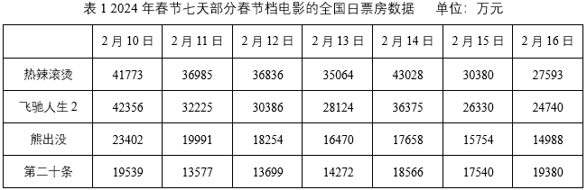
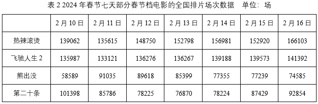

# 材料 · 2024年春节档电影市场：整体票房/观影人次的同比表现，以及四部主要影片（热辣滚

> 关联 1 道小题

**时间口径**：现期为2024年春节档（2月10日—2月16日共7天），两张表均为逐日当期值；文字段给出同比增速，可反推2023年（基期）春节档整体票房与观影人次；材料不含预测年份

**单位与换算**：文字段：总票房80.16亿元、总观影人次1.63亿人次；表1：日票房，单位万元（1亿元=10000万元，跨段与表比较时相差4个数量级）；表2：排片场次，单位场；同比增长率以%计（18.5%、26.4%）

## 结构拆解
- 文字段：给出2024年春节档整体三项关键数据——总票房80.16亿元（同比+18.5%）、总观影人次1.63亿（同比+26.4%）、票房/观影人次/场次均创影史新高；是推算2023年基期总量的唯一数据来源
- 表1（2024年春节七天部分春节档电影的全国日票房数据，单位万元）：行为4部影片（热辣滚烫、飞驰人生2、熊出没、第二十条），列为2月10日至2月16日逐日票房，如热辣滚烫41773/36985/36836/35064/43028/30380/27593、飞驰人生2为42356至24740、熊出没为23402至14988、第二十条为19539至19380
- 表2（2024年春节七天部分春节档电影的全国排片场次数据，单位场）：同样4部影片×7天，逐日排片场次，如热辣滚烫139062至166103、飞驰人生2为135987至141392、熊出没为58589至74585、第二十条为101398至92854

## 阅读陷阱
- ⚠ 量级陷阱：表1单位是万元，文字段总票房是亿元，两者直接比较或相加会差10000倍
- ⚠ 口径陷阱：两张表只是'部分春节档电影'（4部影片），四部逐日加总远小于春节档总票房80.16亿元，不能用表格加总冒充春节档整体数据
- ⚠ 表2是排片场次（供给端指标），不是票房也不是观影人次，三者不可混用；文字段'场次创影史新高'对应的是排片数据
- ⚠ 表内数据为逐日当期值，七天合计需逐日加总；18.5%的同比增速是春节档整体口径，不能直接用于单部影片或单日数据
- ⚠ 基期换算方向：'同比增长18.5%'意味着基期=现期÷(1+18.5%)，误乘(1-18.5%)是高频错误

## 小题群关系
本组仅1题，考查'基期量=现期量÷(1+增长率)'模型：用文字段的2024年总票房80.16亿元和同比增速18.5%反推2023年春节档票房，80.16/(1+18.5%)≈67.6亿元；两张明细表在本题中暂不参与计算，属于为同材料后续可能的题目（如逐日加总、场均票房=日票房÷排片场次等）预留的数据池，目前题与题之间暂无连环复用

## 关联真题
- [[10-真题/资料分析/增长/11226618 基期量计算（已知现期量与同比增长率反推基期）|11226618]] 上海 2025 — 基期量计算（已知现期量与同比增长率反推基期）

---

### 材料原文

        根据相关数据报告显示，2024年春节档电影总票房达80.16亿元，同比增长18.5%。总观影人次1.63亿，同比增长26.4%。票房、观影人次及场次三项关键数据均创下我国影史新高。

