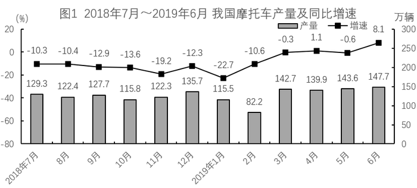

# 材料 · 2018年7月～2019年6月我国摩托车逐月的产量与销量（万辆，柱状）及各自同比

> 关联 5 道小题

**时间口径**：12个月的月度当期值（非累计值），覆盖2018年7月—2019年6月，无预测年份；两图折线为同比增速，对应基期为2017年7月—2018年6月各同月；图中没有2018年上半年及2018年6月的数据

**单位与换算**：产量/销量单位为万辆（柱，读右轴，刻度0～300）；同比增速单位为%（折线，读左轴，刻度-80～20）。两图均为左右双轴，柱与线必须按图例各读各轴；图上数值保留1位小数，做差与求和时注意小数位对齐；无亿元/万吨等其他单位换算

## 结构拆解
- 图1「2018年7月～2019年6月我国摩托车产量及同比增速」：柱=各月产量（万辆，右轴），依次为129.3、122.4、127.7、115.8、122.3、135.7、115.5、82.2、142.7、139.9、143.6、147.7；折线=各月同比增速（%，左轴），依次为-10.3、-10.4、-12.9、-13.6、-19.2、-12.3、-22.7、-10.6、-0.3、1.1、-0.6、8.1。区间内2019年2月产量最低（82.2），2019年6月最高（147.7），正增速仅2019年4月（+1.1）和6月（+8.1）两个月
- 图2「2018年7月～2019年6月我国摩托车销量及同比增速」：柱=各月销量（万辆，右轴），依次为130.3、122.7、128.1、115.9、120.9、134.0、117.2、83.1、142.8、135.2、141.1、147.2；折线=各月同比增速（%，左轴），依次为-8.6、-11.1、14.1、-14.8、-17.2、-11.4、-12.0、-13.6、-0.9、-0.3、-1.3、6.7。注意2018年9月销量同比+14.1%为区间内唯一大正增速（与图1同期产量-12.9%一正一负），2019年2月销量最低（83.1）

## 阅读陷阱
- ⚠ 双轴柱线图混排：柱读右轴（万辆）、线读左轴（%），两轴刻度与零点不同（左轴从-80起、右轴从0起），不能按柱线高低直观比较，看错轴会把产量/销量当成增速
- ⚠ 两张图外形几乎一样且同名指标各一份：产量（图1）与销量（图2）数值非常接近（如2018年10月115.8对115.9、2019年6月147.7对147.2），做题前必须先确认问的是产量还是销量，再进对应图取数
- ⚠ 折线是同比增速（与上年同月比），不是环比；图中未给上月或上年数值时，不能用增速直接推算环比或上年以外的月份
- ⚠ 符号与个别异常点易错：图2中2018年9月+14.1%夹在一串负值中易看漏正号；2019年2月产销双双骤降（82.2、83.1），做季度加总或比较时不可遗漏；图1右上角'8.1'与图2右上角'6.7'位置相近，易张冠李戴
- ⚠ 材料起点为2018年7月，2018年6月及更早月份不在图内；跨月计算（如'2018年7月比上月'）会缺基数，需核对题干所指月份是否真在图示范围内
- ⚠ '相差不超过0.5万辆'之类表述需逐月求产量-销量的绝对值并判断边界（如2019年6月差恰为0.5万辆，属'不超过'应计入），逐月做差共12组、极易数错

## 小题群关系
本组题是同一份12个月产销柱状数据的连环复用，核心模型是『逐月读柱值→做差/求和→比较』，四题基本不需要折线增速。第1题为逐月差值计数题：对12个月求|产量-销量|并统计不超过0.5万辆的月份数（2018年8、9、10月及2019年3、6月等，含边界判断陷阱）；第2题为单月产销差值比较（题干写'2018年1月'，但图示期间从2018年7月起无该月数据，疑为2019年1月——115.5对117.2，产量少1.7万辆，需核对题干）；第3题按字面'2018年7月销量比上月'需2018年6月基数，图中没有，仅图2提供2018年7月同比-8.6%供'比上年同期'口径使用，标注时须核对题干实际口径；第4题为分段季度求和排序：按季度把图1各月产量加总（2018年Q3=379.4、Q4=373.8、2019年Q1=340.4、Q2=431.2）后升序排序，考查跨月分段加总。四题之间没有'上一题结果被下一题引用'的链条，但共用同一批月度柱值，建议逐题标注时先完整抄录两列月度数据再分别计算

## 关联真题
- [[10-真题/资料分析/增长/12536430 基期量计算与基期和差比较|12536430]] 四川 2024 — 基期量计算与基期和差比较
- [[10-真题/资料分析/其他/12536434 分段加总排序比较（季度产量求和）|12536434]] 四川 2024 — 分段加总排序比较（季度产量求和）
- [[10-真题/资料分析/其他/12536429 逐月差值计算与计数比较（产销差绝对值≤阈值计数）|12536429]] 四川 2024 — 逐月差值计算与计数比较（产销差绝对值≤阈值计数）
- [[10-真题/资料分析/增长/12536432 环比增长率计算（缺上月数据，需借同比增速反推基期量）|12536432]] 四川 2024 — 环比增长率计算（缺上月数据，需借同比增速反推基期量）
- [[10-真题/资料分析/综合/12536436 综合分析判断（同比下降计数+环比上升计数+同比增量比较+半年分段加总比较）|12536436]] 四川 2024 — 综合分析判断（同比下降计数+环比上升计数+同比增量比较+半年分段加总比较）

---

### 材料原文

