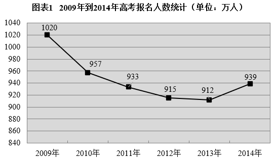
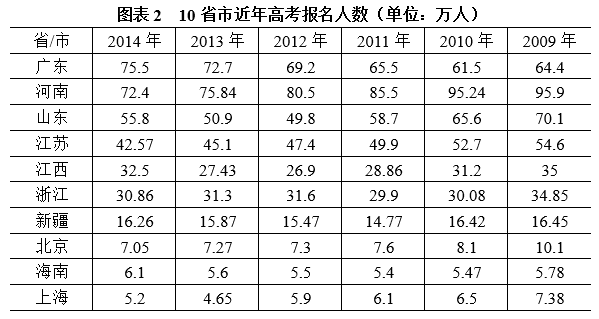

# 材料 · 全国高考报名人数：以2014年为现期（939万人、增幅3%、报名构成变动、异地高

> 关联 1 道小题

**时间口径**：现期为2014年（'今年'），文字段为2014年当年值及相对2013年的同比变动（增量/增幅）；图1为2009—2014年逐年当期报名人数（非累计值），2014年 data 已知非预测；图2为10省市2009—2014年逐年当期报名人数

**单位与换算**：全文统一为万人；文字中为增减量口径（应届生+26万、中职生+11万、复读生-10万、农村户籍+17万）并给出增幅3%；可用基期2013年912万×1.03≈939.4万验证939万；图2数据精确到小数点后两位，量级远小于图1全国总量（最大广东75.5万 vs 全国939万），求'10省市以外地区'需用图1减去图2求和，注意万人单位加总

## 结构拆解
- 文字段：2014年全国高考报名总体情况——总报名939万人、增幅3%；结构增量：普通高中应届生增加26万、中职毕业学生增加11万、复读生减少10万；农村户籍学生增加17万（归因农村专项扩招等政策）；异地高考：2014年28个省份解决随迁子女就地高考，5.6万名符合条件随迁子女在居住地参考
- 图1（折线图）：2009—2014年全国高考报名人数（单位：万人），各年数据为2009年1020、2010年957、2011年933、2012年915、2013年912、2014年939，走势为连续四年下降后2014年反弹回升，2013年为最低点912万
- 图2（表格）：10省市（广东、河南、山东、江苏、江西、浙江、新疆、北京、海南、上海）2009—2014年逐年高考报名人数（单位：万人），按2014年数值从大到小排列；各省市趋势分化：河南（95.9→72.4）、山东（70.1→55.8）、江苏（54.6→42.57）等多数省份总体下行，广东2014年由61.5回升至75.5，上海2013年4.65为低点后回升至5.2

## 阅读陷阱
- ⚠ 文字段'今年'对应图1的2014年（939万）；'增幅3%'是同比增长率而非增量，实际增量为939-912=27万人，勿混用
- ⚠ 文字中的分类增量（+26万、+11万、-10万）只是部分构成的变动，不能据此求和倒推总人数；'农村户籍+17万'与前三项口径不同，四者不可简单相加
- ⚠ 图1纵轴从840起而非从0起，目测折线斜率会放大降幅/涨幅观感，升降与幅度判断须依据标注数值
- ⚠ 图2列标题年份从左到右为2014→2009（倒序），计算同比增减时极易把年份方向看反
- ⚠ 图2中部分省份个别年份回升/波动明显（如广东2014年61.5→75.5、江西2011年28.86、浙江2011年29.9），逐格读数时谨防串行串列；河南2013年75.84为唯一三位小数点后两位非整值，易误读
- ⚠ 图1（全国）与图2（10省市）口径不同，10省市仅为全国一部分，二者之和与全国总量不能直接比较或当成全国构成；跨图表拼数据时才可计算'其余地区'规模

## 小题群关系
本材料仅1道小题，题干限定'根据图表1'，即只依托2009—2014年全国报名人数折线数据做表述正误判断，典型考查模型为同比增减量与增幅计算（如2014年增27万、增幅约3%）、趋势/极值判断（2013年最低、2014年回升）与两年差值比较；文字段与图2在本题中为辅助背景，若后续扩展小题易形成连环复用：用图1全国量减图2十省市和求其余地区、或用文字段结构增量做构成类计算

## 关联真题
- [[10-真题/资料分析/综合/16540245 综合分析·表述正误判断（连续增降计数、跌幅（增长率）比较、峰谷极值差值）|16540245]] 上海 2021 — 综合分析·表述正误判断（连续增降计数、跌幅（增长率）比较、峰谷极值差值）

---

### 材料原文

        教育部统计，今年全国高考报名939万人，增幅3%。其中普通高中应届生增加26万人；中职毕业学生增加11万人；复读生减少10万人。报名学生中农村户籍学生增加17万人，与近年高考政策向农村倾斜及各省农村专项生的扩大招生密不可分。此外异地高考全面实施，2014年将有28个省份开始解决随迁子女在当地参加高考问题，共有5.6万名符合条件的随迁子女将在居住地参加高考。

