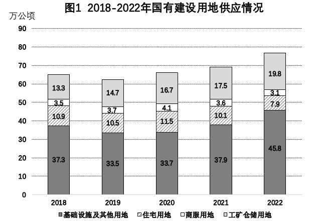

# 材料 · 2018-2022年全国国有建设用地分用途供应情况及土地出让面积与成交价款情况

> 关联 5 道小题

**时间口径**：文字现期为2022年、同比基期为2021年；图1、图2均覆盖2018-2022共5个年度；全部为年度当期值（非累计），不含预测年份；图2中2021与2022年出让面积均为30.7万公顷（与文字'与去年基本持平'呼应）

**单位与换算**：供应/出让面积单位为万公顷；出让成交价款图2左轴为亿元、文字为万亿元（约6.0万亿元=60314.4亿元，注意亿与万亿的量级）；求出让均价时为'亿元÷万公顷'，该商即等于'万元/公顷'，量级换算需小心；比重与增速均为%

## 结构拆解
- 文字段：给2022年现期数——供应总量76.6万公顷（同比+10.9%）；四个分项供应面积及占比：工矿仓储19.8万公顷(25.9%)、商服3.1万公顷(4.0%)、住宅7.9万公顷(10.3%)、基础设施及其他45.8万公顷(59.8%)；出让面积30.7万公顷、成交价款约6.0万亿元（同比-21.9%）
- 图1（2018-2022年国有建设用地供应情况）：堆积柱状图，单位万公顷，四个分项各自给出2018-2022五年数据——基础设施及其他用地37.3/33.5/33.7/37.9/45.8，住宅用地10.9/10.5/11.5/10.1/7.9，商服用地3.5/3.7/4.1/3.6/3.1，工矿仓储用地13.3/14.7/16.7/17.5/19.8；各年供应总量图中未直接标注，需四项相加（2018:65.0、2019:62.4、2020:66.0、2021:69.1、2022:76.6）
- 图2（2018-2022年国有建设用地出让情况）：双轴复合图——柱状为出让面积（右轴，万公顷）：2018:26.0、2019:27.9、2020:31.5、2021:30.7、2022:30.7；折线为出让成交价款（左轴，亿元）：2018:58850.5、2019:66006.0、2020:80409.6、2021:77187.0、2022:60314.4

## 阅读陷阱
- ⚠ 图2为双轴图：柱读右轴（万公顷）、折线读左轴（亿元），极易看错轴导致面积与价款数值混读
- ⚠ 单位换算陷阱：文字'6.0万亿元'与图中'60314.4亿元'是同一数据的两种表述；计算均价时'亿元/万公顷'的量级（相当于万元/公顷）容易出错
- ⚠ 图1是堆积柱：各年供应总量没有直接标注，求2018-2021年供应总量必须四项相加；而2022年总量76.6在文字段中，取数需跨图跨文拼合
- ⚠ 堆积柱数值标签易错位：柱内自下而上依次为基础设施及其他、住宅、商服、工矿仓储，须对照图例确认，不能按标签从大到小想当然
- ⚠ 文字中四个分项占比（25.9%等）是四舍五入结果，与图形原始值一致但计算时应优先用面积原始数据
- ⚠ 图例单位与坐标轴：图2左右轴量纲不同，且柱图数值(30.7)与折线数值(60314.4)同为2022年数据，不要误读为同一指标

## 小题群关系
四题围绕两个基础模型：①同比增速模型（现期/基期-1）——题1比较2022年四个分项供应面积增速（图1中2022与2021列数据，注意住宅、商服为负增长，'增长最快'实际在正增长的工矿仓储约+13.1%与基础设施及其他约+20.8%之间比）；题4考察住宅用地2019-2022年增速走向（约-3.7%、+9.5%、-12.2%、-21.8%，正负交替且整体下行），两题共用图1同一组分项数据。②比值模型——题2的出让均价=图2折线(价款)÷柱(面积)，2019-2022四年中2020年最高；题3的占比=图2出让面积÷图1(或文字)供应总量，需跨图取数并加总堆积柱，2018-2022五年中2020年最高(约47.7%)。题与题之间无上一题结果被下一题直接复用的连环计算，各题独立成算，但共享同一组基期数据与'增速/比值'两套模型。

## 关联真题
- [[10-真题/资料分析/增长/18385420 同比增速比较（增长快慢）|18385420]] 浙江 2024 — 同比增速比较（增长快慢）
- [[10-真题/资料分析/平均数/18385424 现期平均数计算与比较（单价-均价=总额÷数量，跨双轴图取数）|18385424]] 浙江 2024 — 现期平均数计算与比较（单价-均价=总额÷数量，跨双轴图取数）
- [[10-真题/资料分析/增长/18385431 增长率计算与增速走势折线图匹配|18385431]] 浙江 2024 — 增长率计算与增速走势折线图匹配
- [[10-真题/资料分析/比重/18385427 现期比重计算与比较（跨图取数+区间判定）|18385427]] 浙江 2024 — 现期比重计算与比较（跨图取数+区间判定）
- [[10-真题/资料分析/综合/18385434 综合判断题（逐项验证+数据可得性判断）|18385434]] 浙江 2024 — 综合判断题（逐项验证+数据可得性判断）

---

### 材料原文

        2022年，全年国有建设用地供应76.6万公顷，同比增长10.9%。其中，工矿仓储用地、商服用地、住宅用地、基础设施及其他用地供应面积分别为19.8万公顷、3.1万公顷、7.9万公顷和45.8万公顷，占土地供应总量的比重分别为25.9%、4.0%、10.3%、59.8%。全年出让国有建设用地30.7万公顷，与去年基本持平；出让成交价款约为6.0万亿元，同比下降21.9%。

